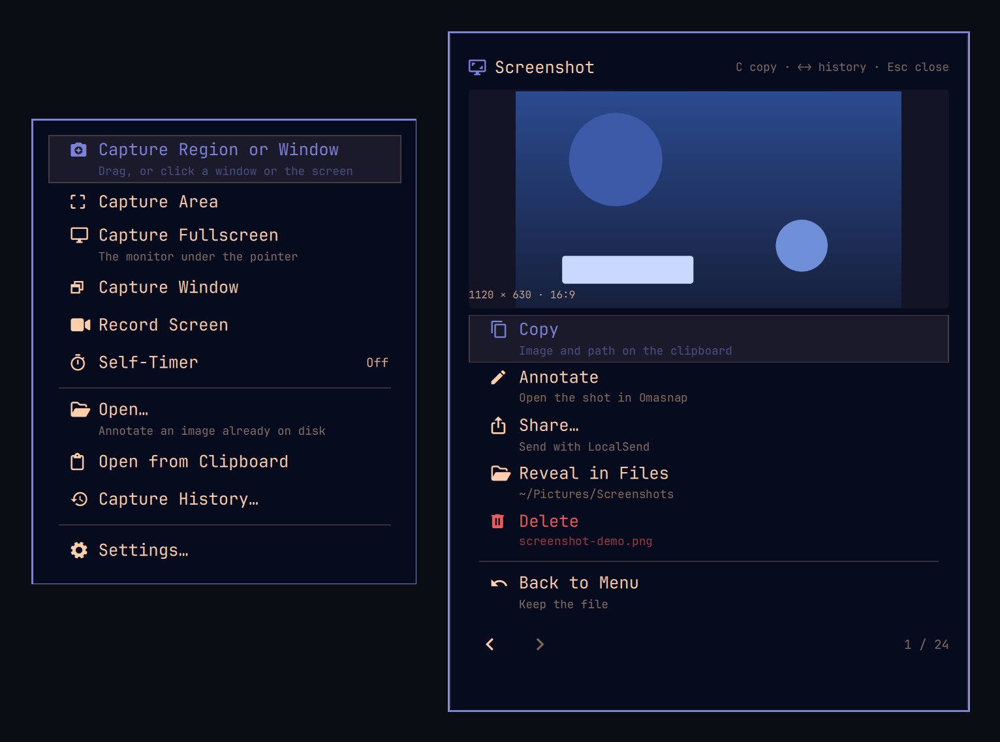

# Snapmenu — a screenshot menu for Omarchy



**Pick a region, window or screen; get a saved shot and a small action card.** Snapmenu
is an [Omarchy](https://omarchy.org) 4.5 screenshot plugin. Open it from the camera
icon in your desktop panel, choose a capture, then copy, annotate, share or delete the
result. The screen freezes while you aim, and the menu stays out of the image.

Snapmenu uses `grim` for screenshots and hands **Annotate** to Omarchy's Omasnap editor.
It does not replace Omasnap's own picker, scrolling capture, pins or editor. Snapmenu's
extra is the quick capture menu, self-timer, previous-area shortcut, local history and
after-capture card. **A capture does not change the clipboard by default**; press `C` on
the card or enable automatic copying in Settings.

## Install

### Requirements

Omarchy 4.5 with Hyprland, Quickshell, `grim`, `jq`, Python 3 and `wl-clipboard`.
Omasnap (included with Omarchy 4.5) opens the annotation editor. A cropper such as `vips`,
ImageMagick or `ffmpeg` makes exact frozen-frame crops faster; without one, Snapmenu
falls back to `grim`. `wtype` is needed only for the interactive tests. The optional
native clipboard helper requires Rust.

```bash
omarchy plugin add https://github.com/analytically/snapmenu --enable
omarchy plugin list
```

`--enable` offers a bar position. If you want **both the image and its file path** on
the clipboard when you press Copy, build the native helper in the installed plugin and
restart the shell:

```bash
cd ~/.config/omarchy/plugins/io.github.analytically.snapmenu
make native
omarchy restart shell
```

Without the helper, Copy offers the PNG image through `wl-copy`, not the path alongside
it. Installing the plugin alone never copies a shot automatically.

There is no default Snapmenu hotkey. On Omarchy's Lua-based Hyprland config, you can add
these to `~/.config/hypr/bindings.lua` after checking that the keys are free (use
`o.rebind` instead if replacing an existing binding):

```lua
o.bind("SUPER + SHIFT + S", "Snapmenu screenshot menu", "omarchy-shell snapmenu.menu toggle")
o.bind("SUPER + SHIFT + A", "Capture area", "omarchy-shell shell call io.github.analytically.snapmenu captureArea ''")
```

## Take a shot

1. Click the camera to open the dropdown. Right-click it to start an area capture
   immediately; middle-click opens history.
2. Choose **Region or Window**. Drag an area, click a window to capture it, or click
   empty space for the focused monitor. The picker shows a still frame, a selection
   outline and the resulting dimensions.
3. The PNG is saved and the action card opens. Press `C` to copy, `A` to open it in
   Omasnap, `S` to share, `R` to reveal it in Files, or `X` to delete it. `Esc`
   dismisses the card without deleting the saved file.

The separate **Area**, **Window** and **Fullscreen** rows skip the other choices.
**Previous Area** repeats the last selected rectangle and appears only after an area has
been recorded. **Self-Timer** waits 0, 3, 5, 10 or 15 seconds; `Esc` cancels the
countdown. **Record Screen** delegates to Omarchy's recorder, and the camera icon
indicates an active recording.

**Open…** selects an existing image for the card. **Open from Clipboard** is offered
only when the clipboard contains an image. **Capture History** lists recent PNGs in the
current export folder; it is a folder view, not Omasnap's separate recents shelf.

### Picker keys

| Input | Action |
|---|---|
| Drag | Select an area |
| Click a window / empty space | Select that window / the monitor in smart mode |
| `Tab`, then `Enter` | Cycle and capture a highlighted window |
| `Shift` while dragging | Keep height fixed; with `Ctrl`, keep width fixed |
| `Esc` or right-click | Cancel |

On the card, `←` and `→` step through nearby shots. Copy, Annotate, Share and Reveal
close the card when used on a result; browsing history remains open. Deleting a saved
shot goes to the Trash unless you choose permanent deletion in Settings.

## Files and clipboard

By default Snapmenu saves `screenshot-YYYY-MM-DD_HH-MM-SS.png` in the XDG
Pictures/Screenshots folder (usually `~/Pictures/Screenshots`). A configured
**Export folder** wins; otherwise `SNAPMENU_DIR`, `OMASNAP_SCREENSHOT_DIR` and the legacy
`OMARCHY_SCREENSHOT_DIR` take precedence in that order. A custom `[output] directory` in
`~/.config/omasnap/omasnap.conf` is **not** read by Snapmenu: set Snapmenu's Export
folder to the same path if you want a shared destination.

Upgrading from an older Snapmenu? Shots previously saved directly in Pictures stay
there. Set Export folder to that old directory if you want them in Snapmenu's history;
history reads one folder at a time. Saved shots may be re-compressed in the background
after the card loads without changing their paths.

**Copy** places an image on the clipboard. With the optional native helper it also
offers the original path as text and a file representation for paste targets; without
the helper only the image is offered. If **Save** is off, a capture lives in a temporary
file while the card holds it. Dismiss the card without handing it off and that temporary
file is removed.

The pointer is omitted by default. Enable **Show cursor** to include it; in an area
capture it appears at its position when the screen was frozen, not at the end of the
drag.

## Settings

Open **Settings…** from the menu, or edit Snapmenu's entry in
`~/.config/omarchy/shell.json`:

| Key | Default | Effect |
|---|---|---|
| `copyToClipboard` | `false` | Copy every new shot immediately |
| `saveToDisk` | `true` | Keep the shot in the export folder; off uses a temporary file |
| `showResult` | `true` | Show the action card after capture |
| `openAnnotate` | `false` | Open every shot in Omasnap instead of showing the card |
| `exportDir` | `""` | Use a custom export folder; empty follows the defaults above |
| `optimizeShots` | `5` | Background PNG re-compression: `0`, `5` or `9` |
| `delay` | `0` | Self-timer in seconds: `0`, `3`, `5`, `10` or `15` |
| `showCursor` | `false` | Include the pointer |
| `glaze` / `dim` | `0.1` / `0` | Selection wash / outside darkening |
| `cardWidth` | `500` | Action-card width, also draggable by its edges |
| `deleteMode` / `confirmDelete` | `"trash"` / `false` | Deletion destination / confirmation |

## Script it

```bash
omarchy-shell snapmenu.menu toggle
omarchy-shell shell call io.github.analytically.snapmenu captureArea ''
omarchy-shell shell call io.github.analytically.snapmenu capturePrevious ''
omarchy-shell shell call io.github.analytically.snapmenu captureAreaAt '1600,900 300x200'
omarchy-shell shell call io.github.analytically.snapmenu openHistory ''
omarchy-shell shell call io.github.analytically.snapmenu debugState ''
```

The fixed rectangle is in global logical coordinates. [DEVELOPING.md](DEVELOPING.md)
documents the other IPC entry points, capture helper and test suites.

## Limits and troubleshooting

- Pinning and scrolling capture are **Omasnap features**, not Snapmenu menu actions. For
  OCR use `omarchy capture text`.
- If an agent pastes text rather than the image, check whether `xclip` is taking
  precedence over Wayland's `wl-paste`. A terminal must also pass the paste keystroke
  through to the agent; a terminal cannot itself send image bytes through ordinary text
  input.
- If a row appears to do nothing, check that its external tool is installed.
  `omarchy-shell shell call io.github.analytically.snapmenu debugState ''` reports the
  current capture stage and recent transitions.
- Automated checks run with `make test`. `make manual` exercises real screen and
  keyboard behavior, changes settings temporarily and may affect the clipboard; see
  [DEVELOPING.md](DEVELOPING.md) before running it.

## Uninstall

```bash
omarchy plugin remove io.github.analytically.snapmenu
# Optional: discard freeze frames, clipboard snapshots and temporary shots:
rm -rf "${XDG_STATE_HOME:-$HOME/.local/state}/snapmenu"
```

Saved screenshots remain in your export folder. See [LICENSE](LICENSE) for the MIT
license and [PUBLISHING.md](PUBLISHING.md) for marketplace details.
